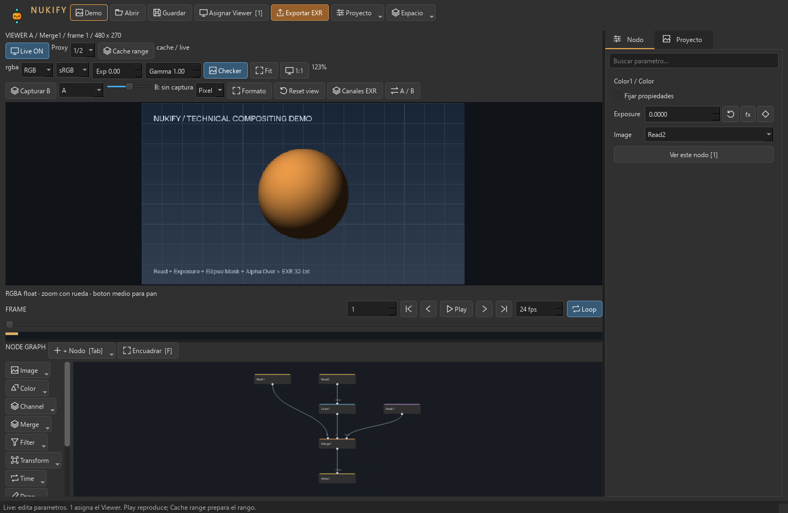
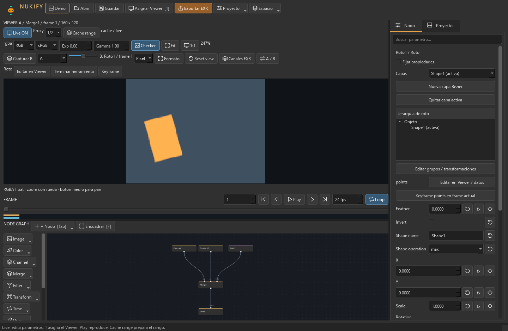
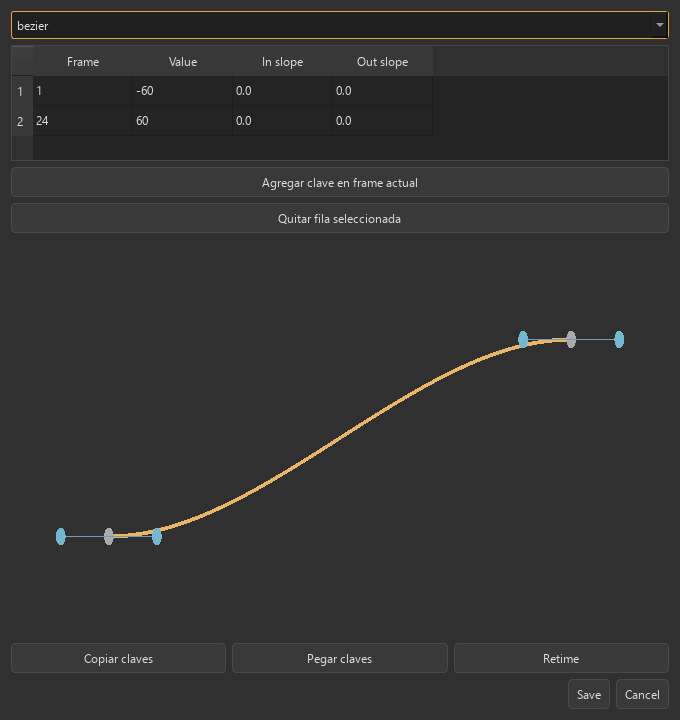
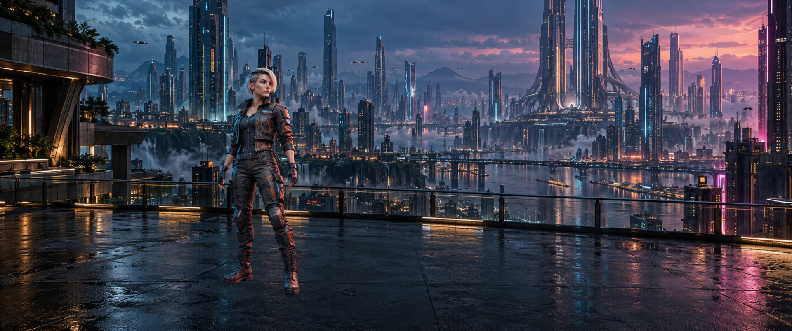
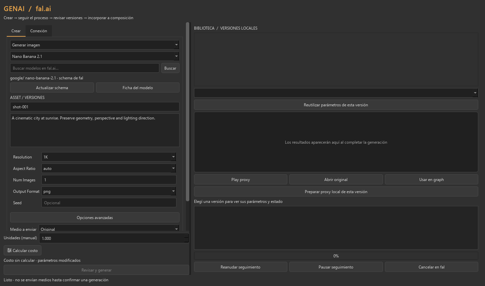

**[English](README.md) | Español**

<div align="center">
  
  <h1>Nukify</h1>
  <p><strong>Composición nodal open source, con Blender como motor.</strong></p>
  <p>Un compositor de escritorio independiente para Windows, creado por <a href="https://github.com/maxsarlijagit">Max Sarlija</a>.</p>
  <p>
    <a href="https://github.com/maxsarlijagit/Nukify/releases"></a>
    <a href="LICENSE"></a>
    
    
  </p>
</div>



Nukify combina una interfaz propia en Qt con el compositor y las herramientas 3D de **Blender 4.5.14 LTS**. El viewer está arriba, los nodos se conectan verticalmente y las propiedades quedan a la derecha. El instalador incluye el motor: no necesitás instalar Python ni Blender por separado para usar la aplicación.

Es una **beta técnica** con workflows funcionales y pruebas automatizadas. No se presenta como sustituto completo de Nuke ni como herramienta ya certificada para producción.

La versión actual del código inicia en **inglés**. Desde **Language / Idioma** en la barra superior podés elegir **English** o **Español**, guardar y volver a abrir Nukify. La preferencia se guarda localmente, por separado de los proyectos. Los identificadores de nodos, valores técnicos, schemas del proveedor y contenidos del usuario conservan sus nombres originales. Esta configuración es independiente de los enlaces de documentación y **está incluida desde la versión 0.10.1**. Consultá [idiomas de la interfaz](docs/guides/interface-languages.md) para ejecutar y probar el código actualizado.

## Descargar e instalar

1. Abrí [Releases](https://github.com/maxsarlijagit/Nukify/releases).
2. Descargá **Nukify-Setup-0.10.1.exe** y ejecutalo en Windows x64.
3. Iniciá Nukify y probá **Proyecto → Ejemplos → Composición** o **Curvas y roto**.

El instalador no tiene firma comercial de código. Verificá su SHA256 con el archivo `SHA256SUMS.txt` publicado en la misma release. La validación se realizó en Windows; falta una prueba completa en una segunda PC limpia.

La distribución incluye fuentes y avisos de los componentes principales dentro de `sources/` y `licenses/`. El repositorio contiene el código propio; los ejecutables y dependencias grandes se distribuyen como assets de la release.

## Qué incluye

| Área | Funciones disponibles |
| --- | --- |
| Interfaz | Tema compacto, iconos vectoriales, inspector con búsqueda, pestañas Nodo/Proyecto, presets de distribución y barras adaptables. |
| Graph | Conexiones verticales, categorías, búsqueda de nodos, selección múltiple, copiar/pegar, bypass, undo/redo y shortcuts configurables. |
| Viewer | Actualización automática, comparación A/B, wipe/difference, exposición y gamma de display, muestreo de píxeles, OCIO y cache por cuadro. |
| Secuencias | Timeline, playback y precarga A/B. La reproducción fluida depende del cache y del costo del grafo. |
| Composición | Nodos de color, filtros, máscaras, merge, transformaciones, tiempo, keying, canales, lectura y escritura. |
| Animación | Keyframes, curvas Bézier, tangentes, retiming y expresiones matemáticas acotadas con referencias entre nodos. |
| Roto | Formas Bézier, grupos jerárquicos, opacidad, transformaciones y motion blur muestreado de máscaras. |
| Tracking | Tracking 2D y planar, correcciones manuales por frame, exclusión de zonas e informes de pérdida/confianza. |
| 3D | Camera, Card, Geometry, Light, Scene, Project3D y RenderLayers. |
| Entrega | EXR/Cryptomatte, cola de renders reanudable y recopilación de proyecto/medios. |

## Capturas

Las imágenes son **capturas de la aplicación real** ejecutando fixtures sintéticos incluidos en el proyecto, no mockups ni planos de clientes.

### Roto, grupos y composición



### Editor de curvas



## Neon Horizon · proyecto demo



Probá una **composición cinematográfica de 22 nodos en 1920 × 804**, con dos originales generados con GPT: personaje cyberpunk sobre chroma y ciudad futurista panorámica. Incluye key/despill, ajuste de luz, sombras de contacto, merge, balance y grano. No requiere API key.

**[Abrir la demo y sus instrucciones](examples/neon-horizon/README.es.md)** · [English](examples/neon-horizon/README.md). Cloná el repositorio o descargá su ZIP para obtener proyecto **y** medios. Es una demo de imagen fija; sus límites están documentados en la guía.

## Primeros pasos

- **Tab**: buscar y crear un nodo en el graph.
- **1 / 2**: asignar el nodo seleccionado al viewer A / B.
- **F**: encuadrar; rueda para zoom y botón medio para pan.
- **Espacio** sobre el graph: maximizar/restaurar ese editor.
- **Espacio → Composición / Viewer amplio / Nodos amplios** en la barra superior: cambiar distribución.
- **Live ON**: actualizar el viewer al cambiar parámetros. **Cache range**: preparar cuadros para playback.
- En propiedades, **fx** edita expresiones y el **rombo** abre controles de animación.

Los atajos se pueden ajustar desde Proyecto → Shortcuts. Consultá la [guía de interfaz](docs/guides/desktop-0.9.md) y la [guía de composición, roto y tracking](docs/guides/desktop-0.8.md).

## Desarrollo y compilación

El entorno de desarrollo usa Python 3.12, PySide6 y Blender 4.5.14 LTS. Las dependencias están fijadas en `requirements-build.txt` y `requirements-worker.txt`.

```powershell
git clone https://github.com/maxsarlijagit/Nukify.git
cd Nukify
```

Seguí [BUILDING.md](BUILDING.md) para preparar las ruedas del worker, configurar Blender, ejecutar pruebas y compilar el instalador. El build público se realiza limpio y registra el commit fuente y los hashes de la aplicación y del motor.

## GENAI Studio (0.10.1)

El botón **GENAI** abre un espacio de generación y edición de imágenes/videos con **[fal.ai](https://fal.ai) como proveedor de inferencia** y tu propia API key: controles por modelo, catálogo destacado y búsqueda, seguimiento de cola, originales/proxies, biblioteca versionada e importación como nodos `Read`. La clave se mantiene en memoria o se toma de `FAL_KEY`.

Incluye Nano Banana 2.1/Pro, GPT Image 2, MiniMax H3 Max y Kling 4/O3 Pro. El costo se consulta por **unidades facturables manuales**; los ajustes de calidad/duración deben revisarse en la ficha del modelo. Cada envío requiere confirmar medios y costo. FFmpeg es necesario para proxies y secuencias de video.

Consultá la [guía GENAI](docs/guides/genai.md) para configuración, alcance y límites. **La compilación 0.10.1 incluye esta función; el instalador 0.9.2 anterior no la incluye.** El build local genera `releases/0.10.1/Nukify-Setup-0.10.1.exe`; verificá en Releases qué instaladores están publicados. La inferencia paga aún no fue validada contra una cuenta real.



## Colaborar con agentes

Podés contribuir con asistencia de un agente de programación. La carpeta **[/agents](agents/README.md)** reúne instrucciones compartidas, responsabilidades, criterios de validación y una plantilla de tarea y entrega.

Empezá por la [guía First Agentic Contribution](agents/FIRST_AGENTIC_CONTRIBUTION.md): elegir una tarea pequeña, preparar tu fork, darle un encargo concreto al agente, revisar la evidencia y enviar un PR. El archivo [AGENTS.md](AGENTS.md) sirve como punto de entrada para herramientas compatibles; si tu herramienta no lo carga automáticamente, pedile que lo lea.

## Validación y límites

- 67 pruebas locales de lógica e interacción Qt en la preparación de esta versión.
- Cinco suites del ejecutable: GENAI local sin red, expresiones/roto, cache A/B, render/cola/medios y regresión de composición/tracking/EXR.
- UI revisada a 1440, 1280 y 1024 px de ancho, con escalado Qt del 100% y 150%.
- Los resultados del binario publicado están en `VALIDATION.json` junto al instalador. CI ejecuta pruebas unitarias; las comprobaciones que necesitan Blender no equivalen a ese job de CI.

Pendientes: validación con planos reales y artistas, uso prolongado HD/4K, cambios físicos entre monitores/DPI, segunda PC limpia, cache de nodos intermedios, ROI y recuperación automática de oclusiones. El tracking planar no es un camera solve 3D. El motion blur de roto no es motion blur general de todas las imágenes.

## Documentación y contribuciones

- [Índice de documentación](docs/README.md) · [Estructura del repositorio](docs/structure.md) · [Proyectos demo](examples/README.md)

- [Compilar y desarrollar](BUILDING.md)
- [Notas de versión en inglés y español](docs/releases/README.md)
- [GENAI: imágenes, videos, proxies y versiones](docs/guides/genai.md)
- [Contribuir](CONTRIBUTING.md)
- [Trabajar con agentes](agents/README.md)
- [Primera contribución agéntica](agents/FIRST_AGENTIC_CONTRIBUTION.md)
- [Sistema de interfaz](docs/development/design-system.md)
- [Roadmap original](docs/planning/roadmap-produccion.md)
- [Estado incremental S15–S17](docs/planning/sprints-0.8.md)
- [Reportar un problema](https://github.com/maxsarlijagit/Nukify/issues)

## Autor y licencia

**Max Sarlija** · [@maxsarlijagit](https://github.com/maxsarlijagit)

Copyright © 2026 Max Sarlija y colaboradores. Código propio bajo **GPL-3.0-or-later**. Ver [LICENSE](LICENSE), [AUTHORS.md](AUTHORS.md) y [THIRD_PARTY.md](THIRD_PARTY.md).

Nukify es independiente y no está afiliado a Blender Foundation ni a Foundry. Las marcas Blender y Nuke pertenecen a sus titulares. Las bibliotecas externas conservan sus licencias y avisos originales.
